<p align="center">
  
</p>

# Mirante

**Painel de inteligência territorial que antecipa problemas de clima, água e serviços públicos em M'Boi Mirim (Zona Sul de São Paulo) e mostra cada alerta com evidência, nível de confiança e limitações, para que a decisão final continue com uma pessoa.**

> Global Solution 2026.2 · Cross-Platform Application Development · Desafio *Territory Predictive Insights* · Flutter

---

## Problema e público

**Território:** Subprefeitura de **M'Boi Mirim**, formada pelos distritos de Jardim Ângela e Jardim São Luís, na margem oeste da Represa Guarapiranga. São cerca de 570 mil moradores (estimativa arredondada), divididos no app em 4 setores de análise.

**O problema.** A região reúne os três temas do desafio: ondas de calor e chuva forte em áreas de encosta, abastecimento de água às margens de um manancial e alta demanda por UBS e coleta de lixo, numa área de alta vulnerabilidade social. Esses problemas costumam ser percebidos só quando já atingem a população. Os dados para antecipá-los existem, mas ficam espalhados e sem uma leitura clara de quanto se pode confiar neles.

**Para quem:**
- **Gestores públicos** (subprefeitura, saúde, saneamento, Defesa Civil), que precisam decidir onde agir primeiro.
- **Cidadãos**, que acompanham o próprio território e relatam ocorrências de forma anônima.

**Impacto social esperado.** Agir **antes** do problema: aviso de calor e chuva com dias de antecedência, vazamentos localizados antes de faltar água, reforço nas UBS antes das filas. O app mede esse impacto em indicadores de benefício social: moradores cobertos por alertas, antecedência média, água recuperável por dia, decisões registradas e relatos de cidadãos.

## Integrantes

| Nome | RM |
|---|---|
| Leonardo Augusto | RM565564 |
| Pedro Gabriel | RM562242 |
| Alexandre Campão | RM563346 |

## Demonstração visual

Prints feitos em emulador Android (Pixel, Android 14), com dados reais de clima do dia 16/11/2026.

| | | |
|:---:|:---:|:---:|
| 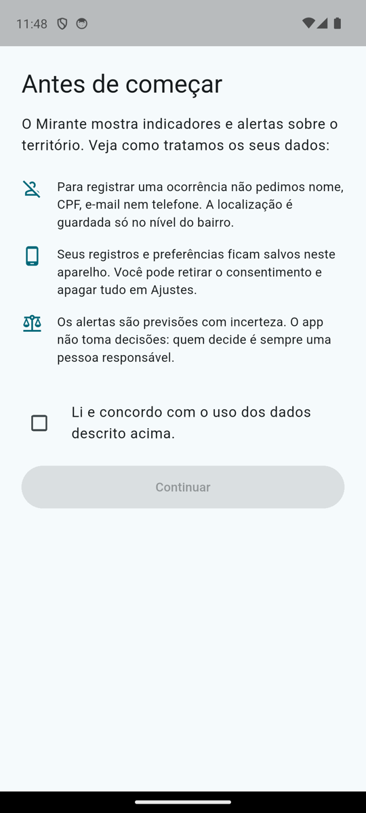<br>**Consentimento** obrigatório no primeiro uso | 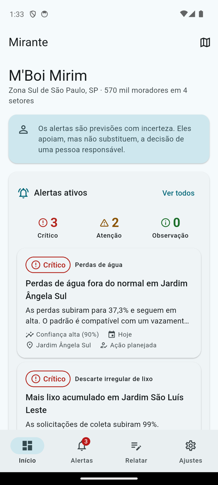<br>**Visão geral**: aviso de decisão humana e alertas ativos | 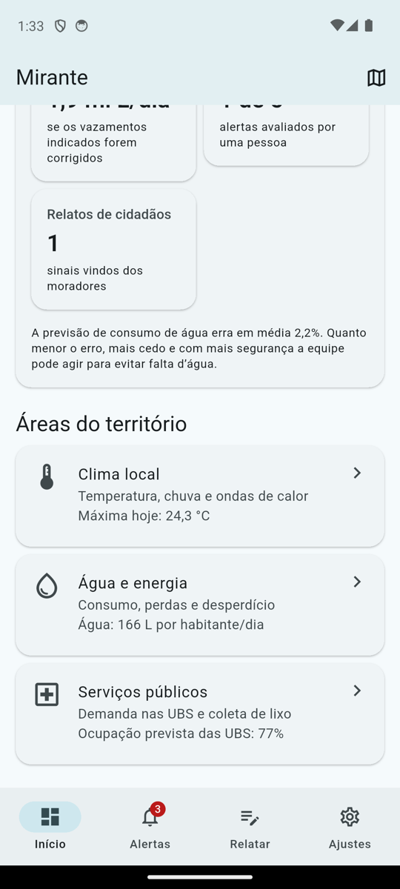<br>**Benefício social**: o que a análise significa para os moradores |
| 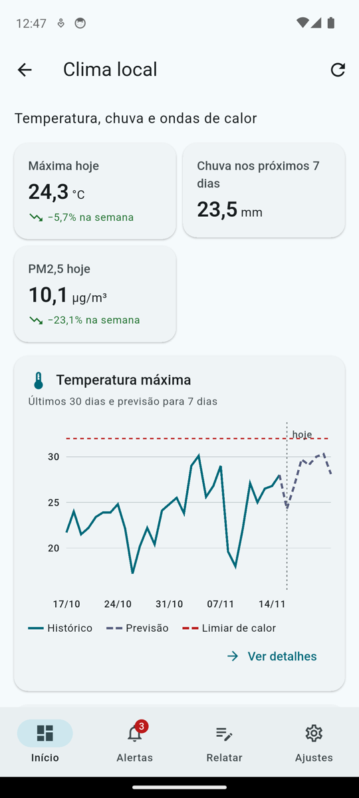<br>**Dashboard 1, Clima** (dados reais): temperatura, chuva e PM2,5 | 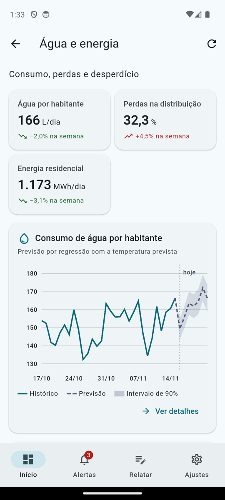<br>**Dashboard 2, Água e energia**: previsão com intervalo de 90% | 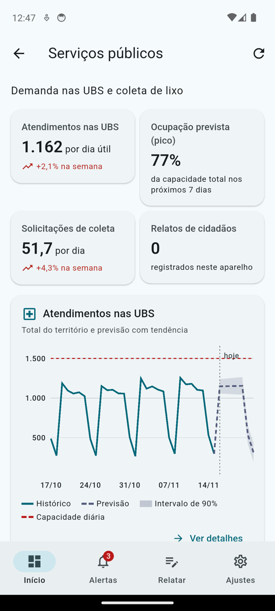<br>**Dashboard 3, Serviços**: UBS, ocupação por setor e coleta |
| 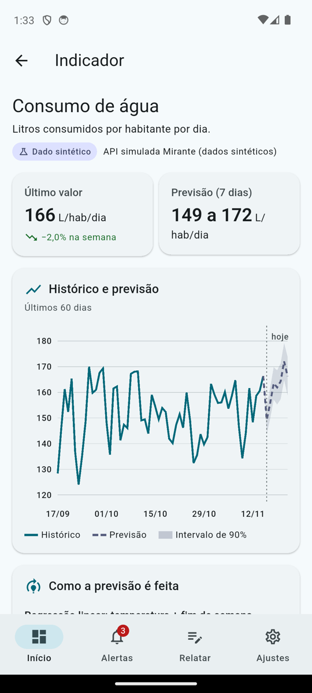<br>**Detalhe do indicador**: 60 dias de histórico e previsão | 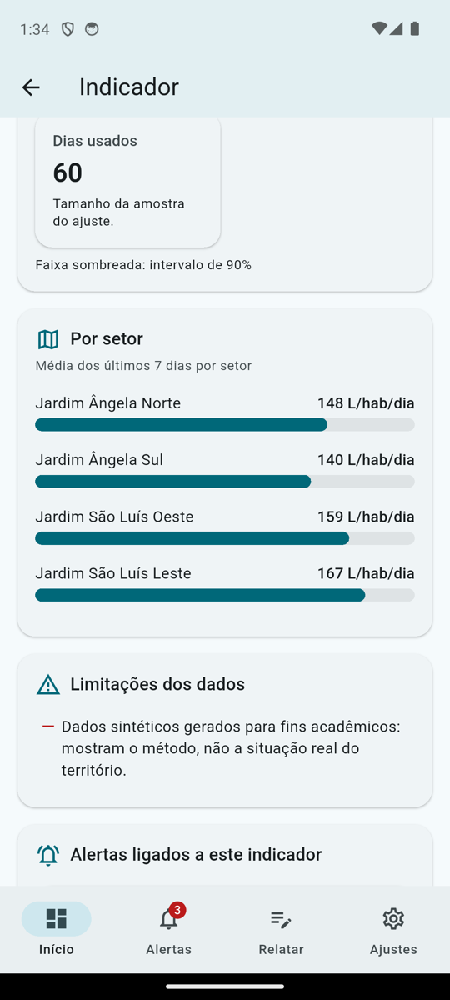<br>**Como a previsão é feita**: R², erro do backtest, amostra | 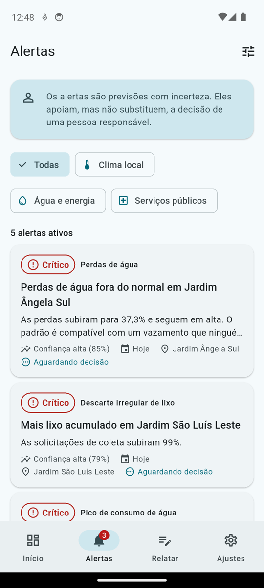<br>**Alertas** com filtro por área e decisão pendente |
| 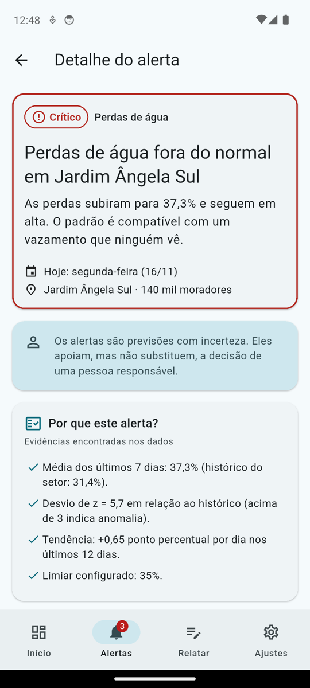<br>**Detalhe do alerta**: evidências encontradas nos dados | 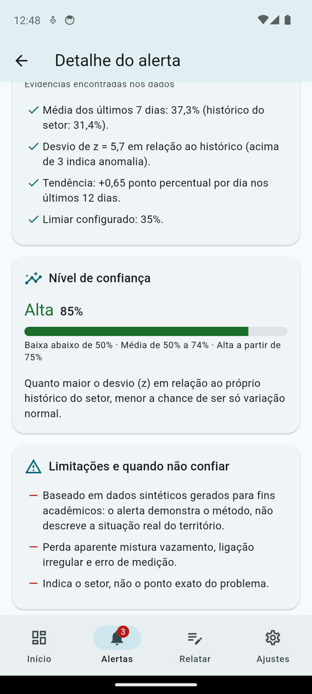<br>**Nível de confiança** e **limitações** do alerta | 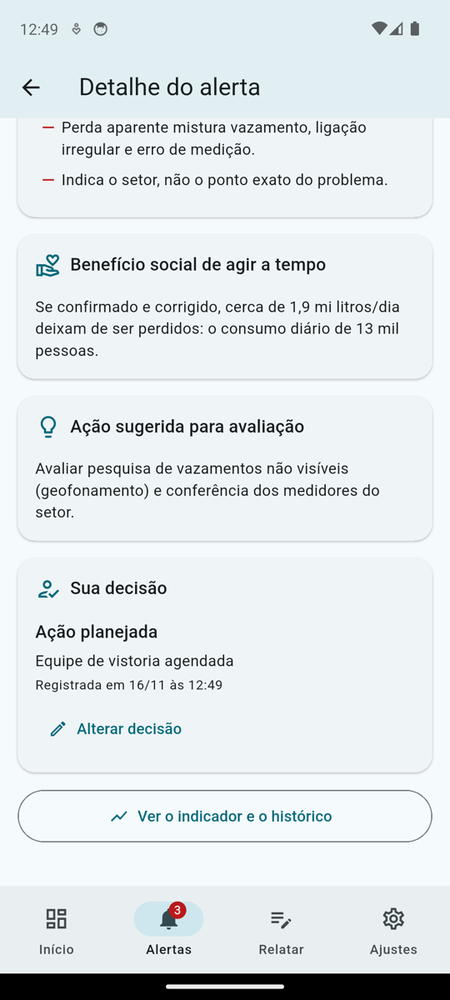<br>**Benefício social**, ação sugerida e **decisão humana** registrada |
| 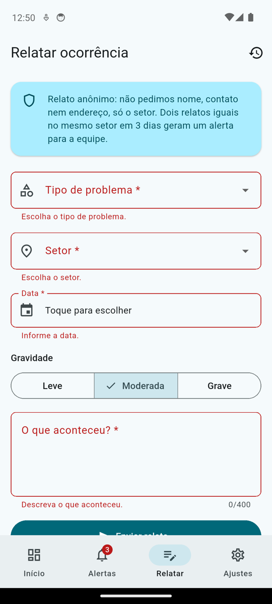<br>**Relatar ocorrência**: validação com mensagens claras | 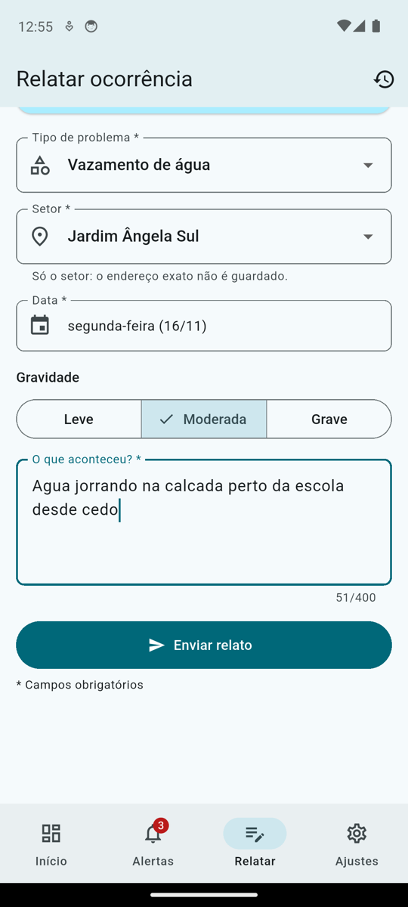<br>Relato **anônimo**: só o setor, sem dados pessoais | 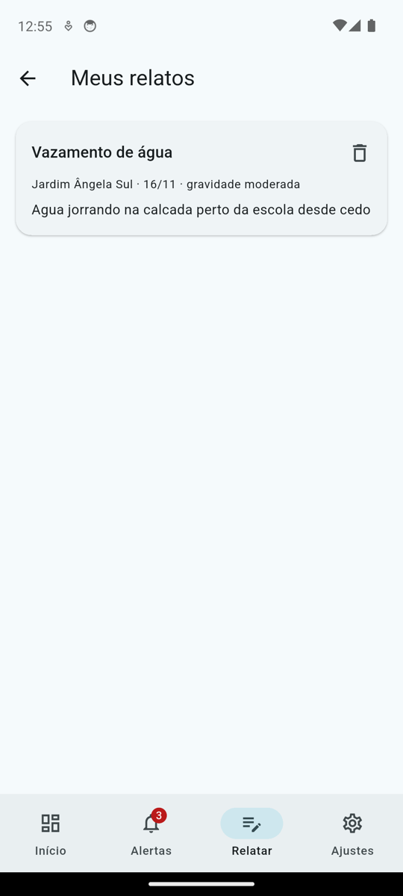<br>**Meus relatos**, salvos no aparelho (funciona offline) |
| 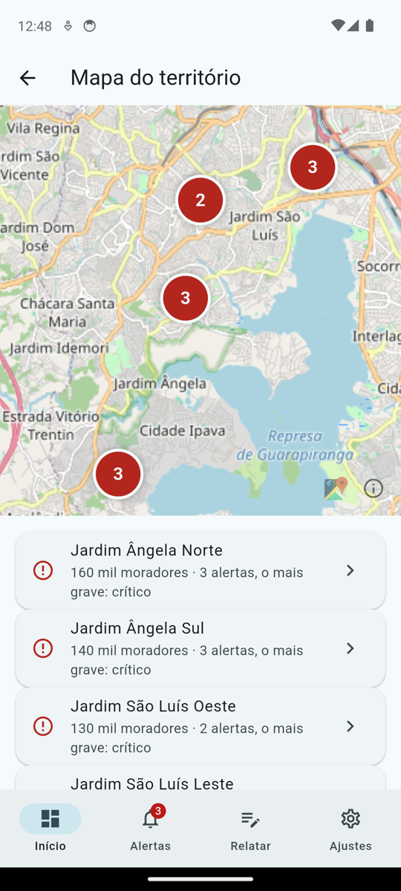<br>**Mapa** dos setores com a severidade dos alertas | 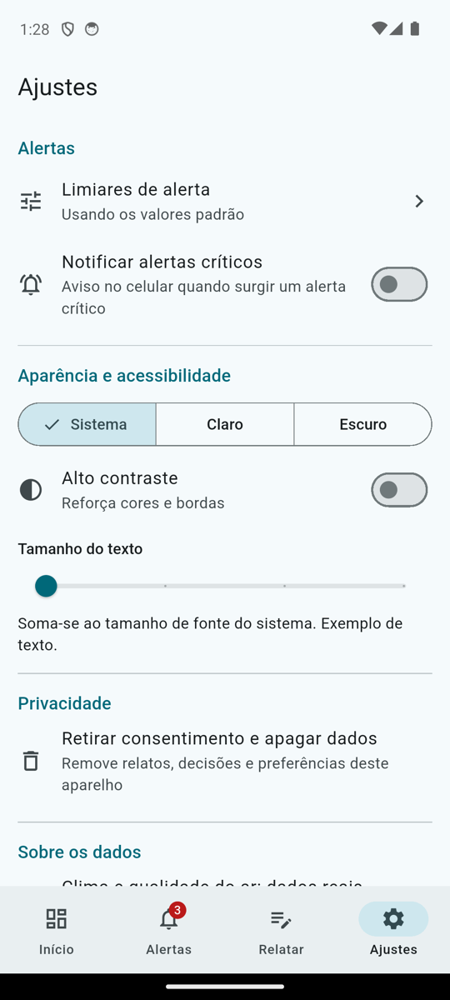<br>**Ajustes**: notificações, tema, contraste, fonte, privacidade | 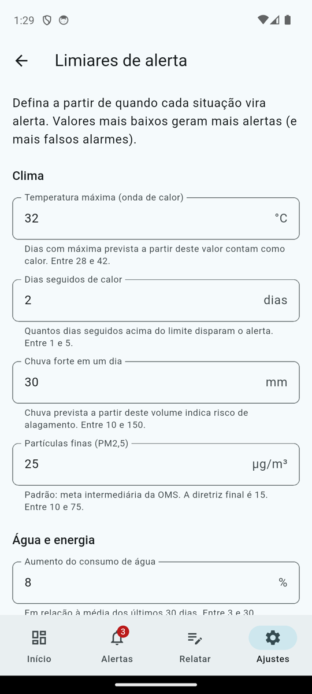<br>**Limiares de alerta**: formulário validado que recalcula os alertas |
| 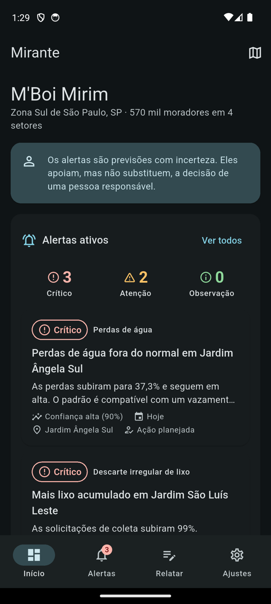<br>**Modo escuro** | 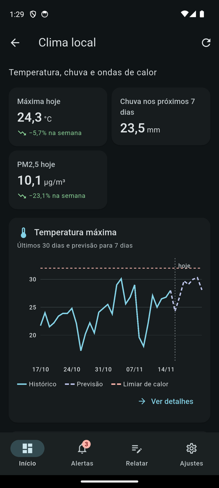<br>Gráficos adaptados ao **modo escuro** | 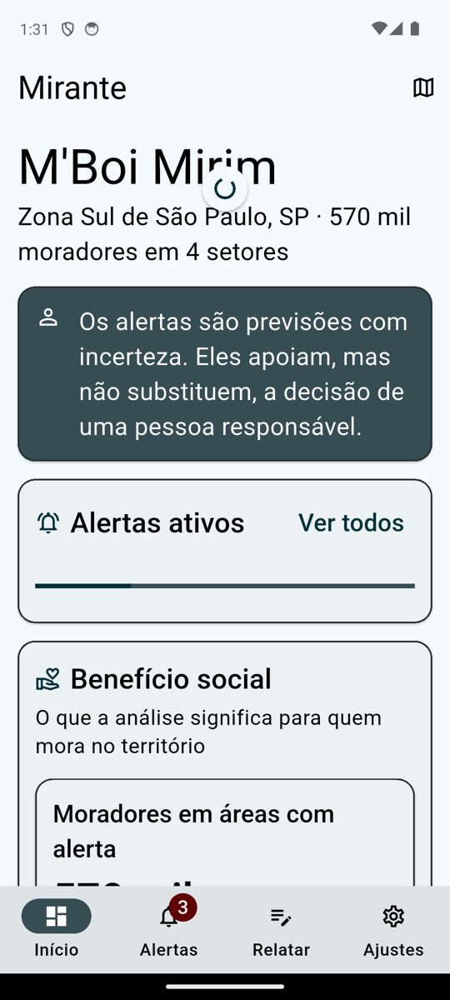<br>**Alto contraste** com **fonte em 160%** |

## Funcionalidades

**Navegação e estado**
- [x] 13 telas com rotas nomeadas (`go_router`), parâmetros de rota e 4 abas que preservam o estado
- [x] Fluxo completo: visão geral → dashboard → detalhe do indicador → detalhe do alerta
- [x] Estado global (Riverpod) compartilhado entre telas: alertas, limiares, decisões, relatos e preferências
- [x] Estado local nas telas (filtro de alertas, campos dos formulários)
- [x] Estados de carregamento, erro (com "Tentar de novo") e lista vazia em todas as telas com dados

**Dados, previsões e alertas**
- [x] Três dashboards com gráficos, cards, histórico, previsão e tendência semanal
- [x] Dados **reais** de clima e qualidade do ar (Open-Meteo), com cache para uso **sem conexão**
- [x] API simulada com dados sintéticos de água, energia, UBS e coleta
- [x] Previsões por regressão linear, com R², erro de backtest (MAPE) e intervalo de 90%
- [x] 9 tipos de alerta, cada um com evidência, nível de confiança, limitações, ação sugerida e benefício social
- [x] Aviso visível em todas as telas de alerta: o app apoia, mas não substitui, a decisão humana
- [x] Registro da decisão humana (ação planejada, monitorar ou falso alarme), salvo no aparelho
- [x] Indicadores de benefício social na visão geral

**Formulários**
- [x] Relato de ocorrência anônimo com validação (campos obrigatórios, data, tamanho e bloqueio de CPF, telefone e e-mail)
- [x] Formulário de limiares de alerta com validação de faixa, que recalcula os alertas em todas as telas
- [x] Registro de decisão com observação validada

**Qualidade, acessibilidade e privacidade**
- [x] Consentimento explícito, revogável em Ajustes (apaga os dados locais)
- [x] Modo escuro, alto contraste e tamanho de texto ajustável
- [x] Rótulos para leitores de tela, resumo em texto dos gráficos e áreas de toque de 48 px
- [x] Layout testado em 360 px e 800 px de largura e com fonte em 160%

**Diferenciais**
- [x] Dados reais (clima e qualidade do ar)
- [x] Mapa dos setores (OpenStreetMap) com lista acessível
- [x] Notificação local para alertas críticos (opcional, com permissão)
- [x] Animações com propósito (transição entre estados, medidor de confiança, números de impacto)
- [x] Modo escuro e alto contraste
- [x] 40 testes automatizados (lógica de alertas, regressão, validações, repositório e fluxos de tela)
- [x] APK de release na aba [Releases](../../releases)

## Dados e alertas

### Fontes de dados

| Área | Dado | Origem | Tipo |
|---|---|---|---|
| Clima | Temperatura máxima e mínima, chuva e probabilidade de chuva (60 dias de histórico + 7 de previsão) | [Open-Meteo Forecast API](https://open-meteo.com/en/docs) | **Real**, aberto, sem chave |
| Clima | Partículas finas PM2,5 (média diária; 30 dias + 5 de previsão) | [Open-Meteo Air Quality API](https://open-meteo.com/en/docs/air-quality-api) (modelo CAMS) | **Real**, aberto, sem chave |
| Água e energia | Consumo de água por habitante, perdas na distribuição e energia residencial, por setor | API simulada do app | **Sintético** |
| Serviços | Atendimentos nas UBS e solicitações de coleta, por setor | API simulada do app | **Sintético** |
| Cidadãos | Relatos de ocorrência | Formulário do app, salvo no aparelho | Autorizado, anônimo |

**Como os dados sintéticos são gerados** (`lib/features/territory_data/data/synthetic_territory_api.dart`): séries diárias determinísticas (a mesma data gera sempre os mesmos números), com sazonalidade semanal, efeito do calor no consumo (usando a **temperatura real** da Open-Meteo quando disponível) e ruído aleatório. Três situações anômalas foram plantadas de propósito para exercitar os alertas: um vazamento crescente no Jardim Ângela Sul, um aumento de demanda nas UBS do Jardim Ângela Norte e uma alta de descarte irregular no Jardim São Luís Leste. Testamos que essas anomalias disparam em 60 dias seguidos de execução, com poucos falsos positivos nos outros setores.

Em todas as telas, cada indicador traz a etiqueta **"Dado real"** ou **"Dado sintético"**.

### Como os alertas são gerados

O motor de alertas (`lib/features/alerts/domain/alert_engine.dart`) é feito de funções puras: o mesmo dado sempre gera o mesmo resultado, e há testes unitários para cada regra.

| Alerta | Regra | Como a confiança é calculada |
|---|---|---|
| Onda de calor | Máxima prevista ≥ limiar (padrão 32 °C) por N dias seguidos (padrão 2), ou um dia 3 °C acima do limiar | Cai 7 pontos por dia de antecedência (de 92% a 35%) |
| Chuva forte | Dia com chuva ≥ limiar (padrão 30 mm) ou 3 dias somando o dobro | Probabilidade de chuva do modelo × antecedência |
| Qualidade do ar | Média diária de PM2,5 prevista ≥ limiar (padrão 25 µg/m³, meta intermediária da OMS) | Teto de 80%: modelos de ar erram mais |
| Pico de consumo de água | Previsão da regressão (temperatura + fim de semana) ≥ média de 30 dias + limiar (padrão 8%) | R² do modelo × antecedência (× 0,7 sem clima real) |
| Perdas de água (por setor) | Anomalia: z ≥ 3 desvios do histórico do setor, ou média de 7 dias ≥ limiar (padrão 35%) | Proporcional ao z; relatos de vazamento no setor reforçam |
| Consumo de energia fora do padrão | Resíduo dos últimos 3 dias ≥ 3 desvios do erro típico da regressão | Proporcional ao desvio |
| Demanda nas UBS (por setor) | Previsão (tendência + dia da semana, 5 semanas) ≥ limiar da capacidade (padrão 90%) | R² do modelo × antecedência |
| Descarte irregular de lixo (por setor) | Média de 7 dias ≥ média dos 30 anteriores + limiar (padrão 30%); vira crítico se houver chuva forte prevista | Proporcional ao aumento acima do limiar |
| Relatos de cidadãos | 2 ou mais relatos iguais no mesmo setor em 3 dias | Fixa e baixa (40–50%): relatos não são verificados |

**Severidade:** Observação, Atenção ou Crítico, sempre com ícone e texto, nunca só com cor. **Confiança:** Baixa (< 50%), Média (50–74%) ou Alta (≥ 75%), exibida em barra e com a explicação de como foi calculada.

**Decisão humana.** Nenhum alerta dispara ação automática. Cada alerta traz uma *ação sugerida para avaliação*, e o gestor registra a decisão (ação planejada, monitorar ou falso alarme), que fica salva no aparelho.

### Métricas

- **R²**: quanto da variação do histórico o modelo explica (0 a 1), exibido no detalhe do indicador.
- **MAPE de backtest**: o modelo é ajustado sem os últimos 7 a 14 dias e o erro percentual médio é medido sobre eles (cerca de 2% no consumo de água). A visão geral relaciona esse erro ao benefício social: quanto menor o erro, mais cedo e com mais segurança a equipe pode agir.
- **Intervalo de 90%**: faixa sombreada nos gráficos de previsão, que se abre conforme a previsão se afasta de hoje.
- **Escore z**: mede o quanto um setor se afasta do próprio histórico; é a base dos alertas de anomalia.

### Limitações e possíveis vieses

- **Dados sintéticos**: água, energia, UBS e coleta demonstram o método, **não** a situação real do território. Todo alerta dessas áreas diz isso.
- **Resolução dos modelos de clima**: alguns quilômetros. Não captam ilhas de calor de uma rua nem a chuva muito localizada do verão.
- **Viés de notificação**: bairros que reclamam menos parecem estar melhor do que estão. Isso afeta coleta e relatos.
- **Perda aparente** mistura vazamento, ligação irregular e erro de medição; o alerta indica o setor, não o ponto exato.
- **Setores e populações** são uma divisão de análise do grupo, com estimativas arredondadas, e não divisões oficiais.
- **Capacidade das UBS** é estimada e não considera faltas de profissionais.

### Quando as previsões não são confiáveis

- **Sem conexão**: o app usa a última cópia salva, avisa a data e reduz a confiança dos alertas de clima em 15%.
- **Mais de 3 dias de antecedência**: o alerta passa a listar esse risco nas limitações.
- **Sem previsão real de temperatura**: os modelos de água e energia usam uma média histórica, e a confiança cai 30%.
- **Eventos fora do histórico** (surtos de dengue, apagões, feriados): modelos lineares não preveem rupturas.
- **Poucos relatos**: dois relatos são um sinal para vistoria, não uma confirmação.

## Privacidade e inclusão

**Proteção de dados pessoais**
- **Consentimento explícito** antes do primeiro uso, explicando o que é guardado e como.
- **Relatos anônimos**: o formulário não tem nome, CPF, e-mail, telefone nem endereço; a localização vai só até o setor. A descrição é **bloqueada** se tiver CPF, telefone ou e-mail.
- **Dados só no aparelho**: relatos, decisões, limiares e preferências ficam no armazenamento local. A única informação enviada às APIs é a coordenada fixa do território.
- **Direito de apagar**: "Retirar consentimento e apagar dados", em Ajustes, remove tudo e volta à tela de consentimento.
- **Sem segredos no código**: as APIs usadas não exigem chave.

**Acessibilidade e inclusão**
- Modo escuro, **alto contraste** e **tamanho de texto** de 100% a 160%, somado ao tamanho do sistema; o layout reorganiza os cards em uma coluna.
- **Leitores de tela**: cada card e botão tem rótulo descritivo e ação; os gráficos têm resumo em texto; o mapa tem lista equivalente.
- Severidade nunca é comunicada só pela cor (ícone + texto).
- Áreas de toque de no mínimo 48 px; animações respeitam a opção de reduzir movimento do sistema.
- Linguagem simples, em português, para gestores e cidadãos.

## Tecnologias e decisões técnicas

| Tecnologia | Por que escolhemos |
|---|---|
| **Flutter 3.47 / Dart 3.13** | Exigência da disciplina; um código só para Android e iOS. |
| **go_router** | Rotas nomeadas com parâmetros (`/painel/:area/indicador/:indicatorId`), abas que preservam o estado (`StatefulShellRoute`) e `redirect` para exigir o consentimento. |
| **flutter_riverpod** | Separa o estado global (providers) do local (`setState`). `AsyncValue` padroniza carregamento e erro, e os providers podem ser trocados por versões falsas nos testes. |
| **shared_preferences** | Guarda preferências, consentimento, relatos, decisões e o cache do clima. São poucos dados, e não há geração de código. |
| **http** | Cliente HTTP oficial do Dart, com nova tentativa e prazo por requisição. |
| **fl_chart** | Gráficos de linha e barra com intervalo de previsão, linhas de limiar e cores do tema. |
| **flutter_map + latlong2** | Mapa com OpenStreetMap, sem chave de API. |
| **flutter_local_notifications** | Notificação local dos alertas críticos, com permissão do usuário. |
| **intl / flutter_localizations** | Datas, números e componentes em pt-BR. |
| **Regressão própria** (`lib/core/analytics`) | Mínimos quadrados em Dart puro: transparente, testável e sem dependência pesada para um modelo pequeno. |

**Arquitetura** (organizada por funcionalidade):

```text
lib/
├── main.dart, app.dart        # inicialização, tema, rotas e escala de fonte
├── core/
│   ├── analytics/             # estatística, regressão linear e previsão com backtest
│   ├── config/                # território e setores
│   ├── domain/                # indicador, série temporal, setor, áreas
│   ├── router/                # rotas nomeadas e barra de abas
│   ├── storage/               # cache JSON e preferências
│   ├── theme/                 # cores, espaçamentos, temas e cores de severidade
│   └── utils/                 # formatação pt-BR
├── shared/                    # componentes reutilizáveis (gráficos, KPIs, estados)
└── features/
    ├── climate/               # Open-Meteo + cache offline
    ├── territory_data/        # API simulada (dados sintéticos)
    ├── indicators/            # construção dos indicadores e tela de detalhe
    ├── alerts/                # motor de alertas, limiares, decisões e telas
    ├── dashboards/            # os 3 dashboards
    ├── overview/              # visão geral e benefício social
    ├── occurrences/           # formulário e lista de relatos
    ├── map/                   # mapa dos setores
    ├── notifications/         # notificação de alertas críticos
    └── consent/ e settings/   # consentimento, ajustes e limiares
```

Cada funcionalidade segue `data` (fontes), `domain` (regras puras), `application` (providers) e `presentation` (telas). Testes ficam em `test/`. O guia de trabalho do grupo está em [`CONTRIBUTING.md`](CONTRIBUTING.md).

## Como executar

**Pré-requisitos:** Flutter 3.47 ou superior, Android SDK (o Android Studio instala o necessário; o projeto compila contra a API 37) e um emulador ou aparelho Android com depuração USB.

```bash
git clone https://github.com/LeonardoAugustoBacelar/GS-CrossPlatform-2026-2.git
cd GS-CrossPlatform-2026-2
flutter pub get
flutter run
```

**Variáveis de ambiente:** nenhuma. As APIs usadas são abertas e não exigem chave. Se alguma chave for adicionada no futuro, ela vai em `env.json` (já no `.gitignore`) e entra com `flutter run --dart-define-from-file=env.json`.

**Sem conexão:** abra o app uma vez com internet para guardar o clima; depois ele funciona offline, avisando a data dos dados salvos.

**Testes e qualidade:**

```bash
flutter analyze   # sem problemas
flutter test      # 40 testes
```

**APK pronto:** baixe o `mirante.apk` na aba [Releases](../../releases) e instale no Android (é preciso permitir apps de fontes desconhecidas). Para gerar o seu: `flutter build apk --release`.

## Vídeo

▶️ **[Assistir à demonstração (2 min 30 s)](https://github.com/LeonardoAugustoBacelar/GS-CrossPlatform-2026-2/releases/download/v1.0.0/mirante-demo.mp4)**

O vídeo, legendado, mostra todas as telas: consentimento, visão geral, os 3 dashboards, o detalhe do indicador, **um alerta sendo gerado** (o gestor baixa o limiar de calor e o alerta aparece com evidência, confiança e limitações), a decisão humana, o relato anônimo com bloqueio de dados pessoais, o uso offline, o mapa e os recursos de acessibilidade.

## Licença

Projeto acadêmico · FIAP · Global Solution 2026.2.
